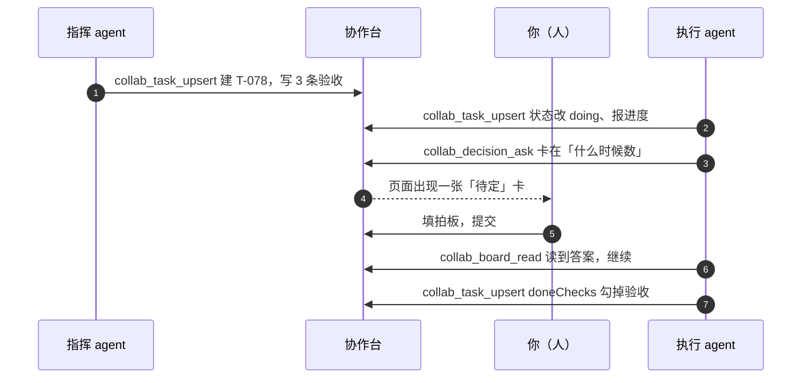
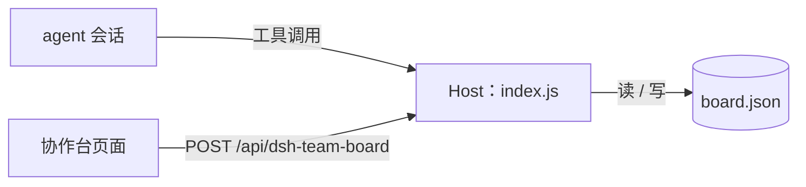

# 协作台 · Collab Board

> 给多 agent 协作装一块人人能看懂的看板：**agent 登记任务、推进验收，人只负责拍板。**

这是一个 [DeepSeek Harness（DSH）](https://github.com/deepseek-ai) 的插件（bundle），装好后侧边栏会多一个「协作台」入口：

- **待拍板**：agent 卡住时抛出的问题卡片，由人填答案；agent 之后自己回读答案继续干活。
- **任务卡**：每条任务带 `指挥 / 执行 / 验收` 三个角色、状态胶囊、进度 `0/3` 和验收清单。
- **三个工具**：`collab_board_read`、`collab_task_upsert`、`collab_decision_ask`，任何 agent 都能读写这块板。

<details>
<summary>English TL;DR</summary>

A DeepSeek Harness plugin that turns multi-agent collaboration into one shared board.
Agents register tasks (commander / executor / reviewer, status, acceptance checks) and post
decision cards; the human answers those cards and nothing else. Three tools expose the board
to any agent; the human-only answer path stays out of the tool surface. State is a plain JSON
file under `$DSH_HOME`. Host + Client halves, no build step, no dependencies.

</details>

---

## 它解决什么问题

多 agent 协作的常见分工是：一个 agent 当指挥拆任务，另一个当执行写代码，人做验收。流程本身没问题，问题出在**信息散在各处**：

| 麻烦 | 没有看板时 | 有了看板 |
| --- | --- | --- |
| 决策 | 人拍板的话淹没在某个会话里，别的 agent 看不到 | 拍板变成卡片，答案跟任务放在一起 |
| 状态 | 任务进行到哪一步要翻会话记录 | 任务卡上写着 `DOING`、`0/3`、验收清单 |
| 角色 | 谁指挥、谁执行、谁验收说不清 | 卡上固定三个字段 |
| 交接 | 换一个 agent / 新开会话，前面聊的等于没发生 | 新 agent 先 `collab_board_read` 就能接上 |

一句话：**把「agent 干活、人拍板」这件事从聊天记录里拎出来，变成一块有结构的板。**

## 界面说明

```
AHP 协作台                                        [ 刷新 ]
项目 1 · 进行中 1 · 待拍板 4
──────────────────────────────────────────────────────────
目标      现在只有「多次对比时」才统计细菌计数，改成：单次检查
          做完 AI 分析后，也用同一套计数代码统计这份数据。
当前任务  T-078
──────────────────────────────────────────────────────────
待拍板 4

1  什么时候数                                            待定
   AI 分析完成后自动数，跟在分析任务里，不加按钮
   ┌────────────────────────────────────────────────┐
   │ 你的拍板...                                     │
   └────────────────────────────────────────────────┘
   [ 提交拍板 ]

4  AI 方案文字要不要提细菌量                              已定
   不动方案文字，只在分析区和报告里显示数字
   拍板结果：同意
──────────────────────────────────────────────────────────
任务 2

T-078  后端：AI 分析后自动统计细菌计数，并提供读取接口   DOING
       指挥 · claude    执行 · deepseek    验收 0/3
       ○ 新测试全过：pytest 550 → 只增不减；ruff 0；…
       ○ git diff 只有 owns 里的文件；counting/** 0 改动
       ○ 读码：全仓只有 QuantityService.count_media 一处调用
──────────────────────────────────────────────────────────
```

交互上有三处：**填拍板并提交**、**点状态胶囊**（`TODO → DOING → DONE`）、**刷新**（页面也会每 6 秒自动轮询，切回窗口时立即刷新）。

## 工作流



角色边界也在这一张图里：

- **指挥 / 执行** 通过工具写板；
- **验收** 是卡上的字段，人可以点状态胶囊直接改；
- **拍板只有人能回答**——`answerDecision` 只开在页面这条通道上，**没有对应的 agent 工具**，agent 只能回读已给的答案。这不是遗漏，是设计（见下方「设计取舍」）。

## 架构



- **Host 半边**（`index.js`）：唯一的数据规则实现方。持久化、三个工具、一个很小的 RPC 路由。
- **Client 半边**（`client.js`）：往 `sidebar.panellist` 注册图标、往 `main` 注册页面，用宿主主题变量画 UI。
- 页面和工具走的是**同一批 Host 函数**，所以页面提交的拍板、agent 写的任务不会各算各的。

## 快速开始

**前提**：DSH Desktop（Web UI 的 profile），本插件在 **0.2.1-rc.5** 上开发验证，其它版本未测。

1. 把本仓库克隆到本地任意目录：

   ```bash
   git clone https://github.com/Ray144165154/dsh-team-board.git
   cd dsh-team-board
   ```

2. 在 DSH 里对 agent 说一句（路径换成你本机的绝对路径）：

   > 把 `/绝对路径/dsh-team-board` 作为 bundle 安装到当前 profile。

   它会在内部调用 `plugin_manager install_bundle`，把包 link 进 profile。

3. 侧边栏出现「协作台」→ 点进去。没出现就刷新一次页面（新装的 Client 模块需要重新加载）。

装好后 `collab_*` 三个工具会出现在所有 agent 的工具列表里，不需要额外配置。

**卸载**：在插件页移除 `@local/dsh-team-board`，或让 agent `plugin_manager remove_bundle`。
**重置数据**：删掉 `~/.dsh/team-board/board.json`，下次读取会重新生成一份示例看板。

## agent 工具参考

三个工具都返回纯 JSON，可以直接被下一步的模型读。

### `collab_board_read`

读整块板；给 `projectId` 就只读一个项目。

```json
{}
```

```json
{ "projectId": "P-1" }
```

返回 `{ projects, decisions, tasks }`（单项目时返回 `{ project, decisions, tasks }`）。已拍板的卡带 `status: "answered"` 和 `answer`。

### `collab_task_upsert`

建任务或更新任务。**不给 `taskId` 就是新建**（自动分配 `T-080` 这样的 id）。

```json
{
  "title": "工作台分析区显示细菌计数图",
  "checks": ["图能渲染", "空数据显示占位"],
  "progressTotal": 2,
  "commander": "claude",
  "executor": "deepseek"
}
```

```json
{
  "taskId": "T-078",
  "status": "doing",
  "doneChecks": ["图能渲染"],
  "progressPassed": 1,
  "note": "等前端联调"
}
```

| 参数 | 类型 | 说明 |
| --- | --- | --- |
| `taskId` | string | 已有任务 id；省略则新建 |
| `projectId` | string | 省略用第一个项目 |
| `title` | string | 标题（新建时必填） |
| `status` | `todo` \| `doing` \| `done` | 状态 |
| `commander` / `executor` / `reviewer` | string | 三个角色 |
| `progressPassed` / `progressTotal` | number | 验收进度 `0/3` |
| `checks` | string[] | 验收项全量替换；**同名的完成态会保留** |
| `doneChecks` | string[] | 本次标记通过的验收项 |
| `note` | string | 卡上的备注 |

### `collab_decision_ask`

发一张待拍板卡。**一个问题一张卡**，标题短一点。

```json
{ "title": "什么时候数", "detail": "**AI 分析完成后自动数**，跟在分析任务里，不加按钮" }
```

`detail` 支持 `**加粗**`。发出后等人回答，agent 用 `collab_board_read` 回读。

## 数据

一块板就是一个 JSON 文件，默认在 `~/.dsh/team-board/board.json`（`$DSH_HOME` 存在时优先用它）：

```jsonc
{
  "version": 1,
  "updatedAt": "2026-11-04T08:08:10.518Z",
  "projects": [{ "id": "P-1", "name": "AHP 协作台", "goal": "…", "currentTask": "T-078" }],
  "decisions": [{ "id": "D-1", "title": "什么时候数", "status": "open", "answer": "" }],
  "tasks": [{
    "id": "T-078", "title": "后端：…", "status": "doing",
    "commander": "claude", "executor": "deepseek", "reviewer": "human",
    "progress": { "passed": 0, "total": 3 },
    "checks": [{ "label": "新测试全过", "ok": false }]
  }]
}
```

写入走 `临时文件 + rename`，并且所有变更串行化；文件损坏时会先备份成 `board.json.corrupt-<时间戳>.json` 再重建，不会直接清空。

## 设计取舍

- **拍板只能人做。** 决策权是这个插件的核心价值，如果 agent 也能回答自己的问题，看板就退化成日志。所以答案通道只开在页面 RPC 上。
- **数据是插件的，不是会话日志的一部分。** 好处是跨会话、跨 agent 共享；代价是 fork/恢复某个会话不会带着板的历史。
- **不做数据库。** 单文件 JSON 在「一个人 + 几个 agent」的规模下够用，坏了也能手改。要多人并发再换存储。
- **轮询而不是推送。** 6 秒轮询一行代码，不需要维护 SSE 连接和重连；页面上的改动频率本来就不高。
- **零依赖、无构建。** 两个纯 JS 文件 + 清单，装完即用，升级不会因为依赖漂移挂掉。

## 已知限制

- 页面只展示**第一个 active 项目**，数据模型支持多个项目，但还没有切换器。
- 没有权限模型：能打开这块页面的人都能拍板（本地单机场景）。
- 没有审计/撤销：拍板和改状态的历史没有留存。
- 没有推送：另一个 tab 改了，本 tab 最多晚 6 秒。

## 路线图

- [ ] **GO 派发**：点一下把任务真的推给某个会话 / agent（从「记录」变「调度」）
- [ ] 人机传话：把人的一句话直接发进指定 agent 的会话
- [ ] tokens / 工具调用数统计到任务卡
- [ ] 验收项逐条点击勾选
- [ ] 多项目切换
- [ ] SSE 实时推送

## 开发与验证

```bash
node test/verify-host.mjs
```

这个脚本用假 Cordis context + 临时 `DSH_HOME` 加载 Host 半边，覆盖 27 项检查：RPC 信封、并发首读、拍板/改状态、重复拍板与空拍板拒绝、错误码、三个工具、重启后持久化。全部通过会打印 `ALL CHECKS PASSED`；它不会碰你真实的 board 文件。

> 页面视觉没有在自动化里核对（无浏览器控制），仓库内的界面示意是结构草图，不是截图。

## 目录结构

```
.
├── index.js              # Host：存储 + 三个工具 + RPC
├── client.js             # Client：侧边栏图标 + 协作台页面
├── package.json          # bundle 清单（dsh.bundle / dsh.client）
├── cordis.patch.yml      # 把插件插入 profile 的 patch
├── locale/{zh,en}.json   # 插件页显示的名称与描述
├── icon.svg              # 插件图标
├── test/verify-host.mjs  # 行为回归脚本
└── README.md
```
