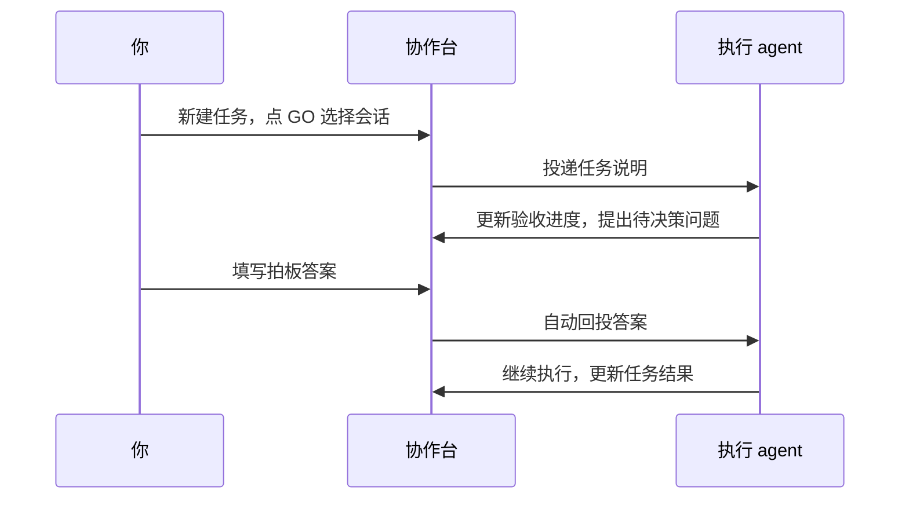

# 协作台 · Collab Board

[](https://github.com/Ray144165154/dsh-team-board/actions/workflows/ci.yml)

**在 DeepSeek Harness 里，用一块看板管理多个 AI 会话的任务、进度和待决策事项。**

当你同时让几个 agent 做事时，任务往往散在不同对话里：谁在做、做到哪一步、哪个问题等你决定，都要翻聊天记录才能找到。协作台把这些信息集中起来，让你在 DSH 侧边栏就能派发任务、查看验收进度，并把决定发回对应会话。

它适合「一个人 + 几个 AI agent」的本地协作。安装后，DSH 侧边栏会新增一个 **协作台** 入口。

[安装使用](#安装使用) · [工具与接口](docs/reference.md) · [真机验证](docs/verification-2026-11-11.md) · [更新日志](CHANGELOG.md)

## 你可以用它做什么

| 你想做的事 | 协作台怎么帮忙 |
| --- | --- |
| 把任务交给某个 agent | 在任务卡上点 **GO**，选择已打开的会话，任务说明会直接投递过去 |
| 看清任务进度 | 卡片显示 TODO / DOING / DONE、验收清单和通过数；人可以勾选，agent 也能通过工具更新 |
| 处理 agent 的疑问 | agent 发出一张「待拍板」卡，你在页面回答，答案自动发回提问会话并留档 |
| 临时补充一句要求 | 用「传话」向指定会话发送消息，例如“先完成后端，前端暂缓” |
| 同时管理几件事 | 新建、切换项目，按项目查看目标、任务和决策；任务相关问题可以关联任务 ID |
| 让新会话接手 | agent 先读取看板，了解任务分工、验收项和已记录的决定 |

任务数据包含「指挥、执行、验收」三个角色字段，用来记录分工；它们不会自动创建 agent、限制工具权限或检查代码是否真的通过验收。

## 一次协作怎么进行

以“给学习网站增加深色模式”为例：

1. **登记任务。** 你在页面新建任务，或让指挥 agent 通过工具写入标题、分工和验收清单。
2. **派发工作。** 先在 DSH 打开执行会话，再回到任务卡点 GO，选择这个会话。
3. **等待拍板。** 执行 agent 遇到“默认跟随系统，还是让用户手动切换”的问题，用工具发出决策卡。
4. **给出答案。** 你在协作台填写决定，答案会自动投回提问会话，agent 据此继续。
5. **确认结果。** agent 报告通过的验收项，你查看结果、补充传话或调整任务状态。



**“已投递”表示消息进入了目标会话的收件箱。** 是否处理完成，要看 agent 的回复、任务状态和验收结果。

## 安装使用

需要先安装 **DeepSeek Harness（DSH）Desktop**。本插件已在 DSH **0.2.2-rc.1** 上验证，其他版本的宿主接口兼容性尚未确认。

### 1. 下载项目

```bash
git clone https://github.com/Ray144165154/dsh-team-board.git
cd dsh-team-board
```

插件本身没有额外的运行时依赖，也没有构建步骤；React、会话和工具服务由 DSH 提供。

### 2. 安装到 DSH

在 DSH 中让 agent 执行下面的要求，把路径换成你自己的绝对路径：

> 把 `/绝对路径/dsh-team-board` 作为 bundle 安装到当前 profile。

Windows 路径示例为 `C:\Users\你的用户名\Projects\dsh-team-board`。安装由宿主的 `plugin_manager install_bundle` 完成；协作台的三个工具随后会注册到该 profile。

安装是链接到本地目录的方式，请保留这个目录。更新代码后，**重启 DSH，再刷新页面**，确保 Host 和 Client 同时加载新版。

### 3. 打开协作台

在 DSH 侧边栏点击 **协作台**。首次读取会生成示例项目、任务和问题，供你了解界面；示例不会自行开始执行。可以点击「新建项目」开始自己的工作。

派发前先打开目标会话。如果下拉框里没有它，点击「刷新会话」。列表包含已加载的普通会话和可用的 Agent Teams 队友，不包含临时 subagent。

## 平台支持与验证

| 平台 | 当前证据 | 尚未覆盖 |
| --- | --- | --- |
| macOS | 自动化检查通过；DSH 0.2.2-rc.1 真机跑通看板读取、多项目派发、决策归属、拍板回投和传话 | 其他 DSH 版本 |
| Windows | 三平台 CI 中的 Windows 检查通过；实现未使用 macOS 专属接口 | DSH 真机界面和完整投递流程 |
| Linux | 三平台 CI 中的 Linux 检查通过；实现未使用 macOS 专属接口 | DSH 真机界面和完整投递流程 |

Windows / Linux 在实现上具备跨平台基础，但模拟测试通过不能代替宿主真机验证。macOS 的具体检查过程见[真机验证记录](docs/verification-2026-11-11.md)。

## 给 agent 的三个工具

| 工具 | 用途 |
| --- | --- |
| `collab_board_read` | 读取全板或指定项目的任务、目标和决策 |
| `collab_task_upsert` | 新建或更新任务、角色、验收项与备注 |
| `collab_decision_ask` | 提出需要人回答的问题，并记录来源会话 |

你可以对 agent 这样说：

> 先用 collab_board_read 读取看板。在我指定的项目中登记任务，写清验收项；需要我决定时，用 collab_decision_ask 发卡并携带 taskId。每完成一项验收，就用 collab_task_upsert 更新 doneChecks。

多项目协作时，建议始终携带明确的项目或任务 ID。上下文不唯一时，工具会要求补充归属，避免问题落进错误项目。拍板没有对应的 agent 回答工具，按设计由人在页面完成；本插件尚未提供独立的权限隔离模型。

完整参数、JSON 示例、RPC 契约及数据格式见[开发与接口参考](docs/reference.md)。

## 数据保存与异常处理

看板保存在本机的一个 JSON 文件中：

| 环境 | 默认位置 |
| --- | --- |
| macOS / Linux | `~/.dsh/team-board/board.json` |
| Windows | `%USERPROFILE%\.dsh\team-board\board.json` |
| 自定义 DSH_HOME | `DSH_HOME` 对应目录下的 `team-board/board.json` |

这些数据不依附于某一个聊天记录，恢复或分支一个会话不会同时恢复看板。消息投递后会进入 DSH 会话；会话中的内容如何交给模型处理，仍由宿主管理。

当前源码包含以下保护：

- **保存成功才更新缓存。** 写入失败时不把未保存的状态展示成已完成的修改。
- **先备份再恢复损坏文件。** 备份失败时保留原文件并停止重建；Windows 文件锁重试耗尽后也不会直接覆盖原文件。
- **按请求 ID 防重复投递。** 页面会为失败重试沿用请求 ID；已经确认成功的同一请求不会重复发送。
- **不确定时提示核对会话。** 发送与回执保存之间发生中断时，不会盲目自动重发；核对目标会话后再决定是否重新发送。
- **忽略迟到的旧快照。** 页面按已保存的版本号更新，避免旧轮询响应把新状态覆盖回去。

具体的请求 ID、重试和强制重发规则见[接口参考](docs/reference.md#页面-rpc)。这些机制不提供看板文件与宿主收件箱之间的事务性“恰好一次”投递保证。

## 当前边界

- 面向本地单人使用，没有多人权限管理、完整修改审计或撤销。
- 页面可以新建项目和任务、改任务状态、勾验收项；**完整任务编辑表单、项目/任务删除与归档尚未实现**。任务标题、角色、备注和清单目前通过工具或 RPC 修改。
- GO 只能派发到已打开的会话，不会替你新建会话、选择模型或切换工作目录。
- 页面约每 6 秒刷新一次，切回窗口也会刷新；尚未使用实时推送。
- 顶部计数是全局统计，任务和决策内容按所选项目显示。
- 共用同一 DSH_HOME 的 profile 共享看板；不支持多个 Host 进程同时写同一份文件。
- 每条任务的派发和传话历史各保留最近 10 条；防重复投递日志暂不自动清理。

## 开发与检查

Host 位于 `index.js`，负责存储、工具、RPC 和会话投递；Client 位于 `client.js`，负责侧边栏入口和页面。两者共享同一套 Host 数据规则。

```bash
node test/verify-host.mjs
node test/check-client.mjs
node test/verify-reliability.mjs
node test/verify-client-retry.mjs
node test/verify-board-rules.mjs
```

当前共有 **186 项检查**：Host 行为 77 项、Client 静态契约 14 项、故障注入 41 项、客户端重试/快照/RPC 18 项、看板规则 36 项。测试使用临时数据或模拟上下文，不修改真实看板；CI 在 macOS、Windows 和 Linux 上运行同一套脚本。

架构、目录结构和完整接口见[开发文档](docs/reference.md)，历史变更见 [CHANGELOG](CHANGELOG.md)。

<details>
<summary>English overview</summary>

Collab Board is a DeepSeek Harness plugin for one person coordinating several AI agents. It brings tasks, acceptance checks and human decisions into a shared sidebar panel. Dispatch a task to an open session with GO, answer a decision card, or send a message directly to a chosen session.

Three agent tools read the board, update tasks and ask for human decisions. State is stored in a local JSON file. The plugin adds no runtime dependencies or build step and relies on DSH services. The macOS workflow has been tested in DSH 0.2.2-rc.1; Windows and Linux have automated CI coverage but no complete live-host validation yet.

</details>

## 许可证

[MIT](LICENSE) © 2026 Ray144165154
