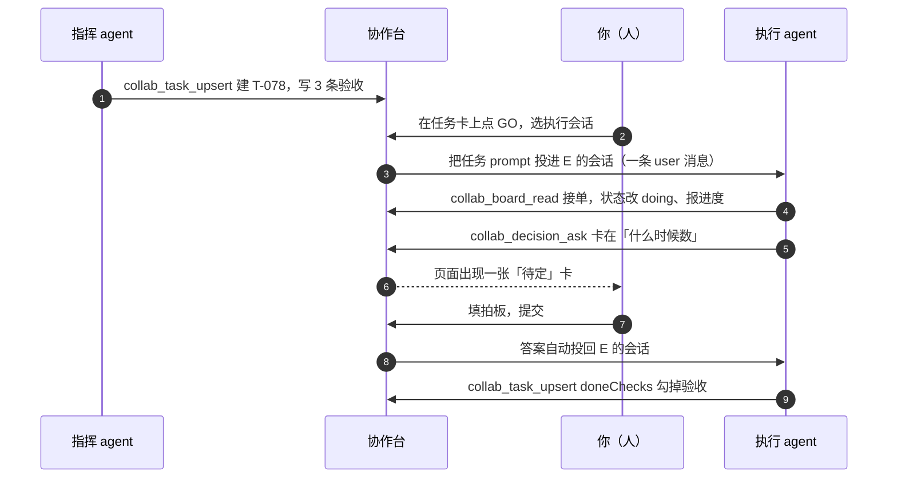
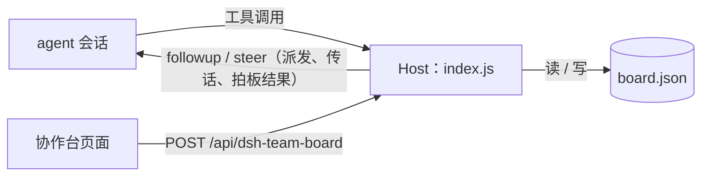

# 协作台 · Collab Board

[](https://github.com/Ray144165154/dsh-team-board/actions/workflows/ci.yml)

> 给多 agent 协作装一块人人能看懂的看板：**agent 登记任务、推进验收；人负责把任务派发出去、把决定拍下来。**

这是一个 DeepSeek Harness（DSH，本地运行的桌面 agent 应用）插件，装好后侧边栏会多一个「协作台」入口：

- **GO 派发**：任务卡上点 `GO`，选一个已打开的会话，任务会被真的推给那个 agent——状态自动转 `doing`，并记下派发目标。
- **人机传话**：拍板答案会自动发回提问的会话；页面底部的「传话」框可以把人的一句话直接发进指定 agent 的会话。
- **待拍板**：agent 卡住时抛出的问题卡片，由人填答案；答案留在板上，同时投递给提问的会话。
- **任务卡**：每条任务带 `指挥 / 执行 / 验收` 三个角色、状态胶囊、进度 `0/3` 和验收清单，验收项点一下就能勾。
- **多项目**：顶部可切换项目、直接新建项目；任务也能在页面里建，不依赖 agent。
- **三个工具**：`collab_board_read`、`collab_task_upsert`、`collab_decision_ask`，任何 agent 都能读写这块板。

<details>
<summary>English TL;DR</summary>

A DeepSeek Harness plugin that turns multi-agent collaboration into one shared board.
Agents register tasks (commander / executor / reviewer, status, acceptance checks) and post
decision cards; the human answers those cards and nothing else. A task card's `GO` button
pushes the task into a live agent session, decision answers are relayed back to the asking
session automatically, and a compose box sends a free-text human message into any open
session. Three tools expose the board to any agent; the human-only answer path stays out of
the tool surface. Projects, tasks and acceptance checks are also editable from the page
itself. State is a plain JSON file under `$DSH_HOME`. Host + Client halves, no build step,
no dependencies.

</details>

---

## 它解决什么问题

多 agent 协作的常见分工是：一个 agent 当指挥拆任务，另一个当执行写代码，人做验收。流程本身没问题，问题出在**信息散在各处**：

| 麻烦 | 没有看板时 | 有了看板 |
| --- | --- | --- |
| 决策 | 人拍板的话淹没在某个会话里，别的 agent 看不到 | 拍板变成卡片，答案自动发回提问的会话，也留在板上 |
| 调度 | 任务写完还得有人复制到 agent 会话里 | 任务卡上点 `GO`，选会话即派发 |
| 回话 | 想补一句话得切到对应会话再打一遍 | 「传话」框直接发进指定会话 |
| 状态 | 任务进行到哪一步要翻会话记录 | 任务卡上写着 `DOING`、`0/3`、验收清单 |
| 角色 | 谁指挥、谁执行、谁验收说不清 | 卡上固定三个字段 |
| 交接 | 换一个 agent / 新开会话，前面聊的等于没发生 | 新 agent 先 `collab_board_read` 就能接上 |

一句话：**把「agent 干活、人拍板」这件事从聊天记录里拎出来，变成一块有结构的板。**

## 界面说明

```
AHP 协作台                                        [ 刷新 ]
项目 2 · 进行中 2 · 待拍板 4
项目 [ AHP 协作台 ▾ ]  [ 新建项目 ]
──────────────────────────────────────────────────────────
目标      现在只有「多次对比时」才统计细菌计数，改成：单次检查
          做完 AI 分析后，也用同一套计数代码统计这份数据。
当前任务  T-078
──────────────────────────────────────────────────────────
待拍板 4

1  什么时候数                                            待定
   AI 分析完成后自动数，跟在分析任务里，不加按钮
   ┌────────────────────────────────────────────────┐
   │ 你的拍板...                                     │
   └────────────────────────────────────────────────┘
   [ 提交拍板 ]

4  AI 方案文字要不要提细菌量                              已定
   不动方案文字，只在分析区和报告里显示数字
   拍板结果：同意
   ✓ 已传达 · 执行会话 · 21:04:12
──────────────────────────────────────────────────────────
任务 2                                            [ 新建任务 ]

T-078  后端：AI 分析后自动统计细菌计数，并提供读取接口   DOING  [ GO ]
       指挥 · claude    执行 · deepseek    验收 0/3
       已派发 · 执行会话 · 21:05:30
       ○ 新测试全过：pytest 550 → 只增不减；ruff 0；…
       ○ git diff 只有 owns 里的文件；counting/** 0 改动
       ○ 读码：全仓只有 QuantityService.count_media 一处调用
──────────────────────────────────────────────────────────
传话                                           [ 刷新会话 ]
会话 [ 执行会话 · 空闲 ▾ ]
┌──────────────────────────────────────────────────────┐
│ 把一句话发进这个会话…                                 │
└──────────────────────────────────────────────────────┘
[ 发送 ]  已投递 · 执行会话 · 21:06:02
──────────────────────────────────────────────────────────
```

示意图里的 `○` 是可点的验收项，`GO` 用来把任务派发到某个已打开的会话。交互上一共八处：**填拍板并提交**、**点 `GO` 派发任务**、**底部传话**、**点验收项**（`○ → ●`，进度自动重算）、**点状态胶囊**（`TODO → DOING → DONE`）、**切换 / 新建项目**、**新建任务**、**刷新**（页面也会每 6 秒自动轮询，切回窗口时立即刷新）。

派发和传话只会出现在「已打开（live）」的会话上：DSH 的会话要先被加载成 live agent，才能接收新消息。页面里的会话下拉会读出会话标题、运行 / 空闲状态；Agent Teams 的队友会话也会列出来（标记为「队友」），临时 subagent 会话则被过滤掉。切换会话后如果列表变了，点一下「刷新会话」。

## 工作流



角色边界也在这一张图里：

- **指挥 / 执行** 通过工具写板；
- **验收** 是卡上的字段，人可以点状态胶囊直接改；
- **拍板只有人能回答**——`answerDecision` 只开在页面这条通道上，**没有对应的 agent 工具**。但答案不再是「等 agent 自己想起来读」：提交时 Host 会把答案作为一条 user 消息投递给提问的会话，agent 下一轮就能看到。这是设计里的「最后一公里」，见下方「设计取舍」。

## 架构



- **Host 半边**（`index.js`）：唯一的数据规则实现方。持久化、三个工具、RPC 路由，以及把人的动作投递进 live 会话的「最后一公里」。
- **Client 半边**（`client.js`）：往 `sidebar.panellist` 注册图标、往 `main` 注册页面，用宿主主题变量画 UI。
- 页面和工具走的是**同一批 Host 函数**，所以页面提交的拍板、agent 写的任务不会各算各的。
- 投递走 DSH 的 `agents` 服务：`agents.get(sessionId)` 拿到 live agent，再用 `agent.followup(message)` 把消息放进它的收件箱（运行中的 agent 可选 `steer`）。投递成功只代表消息被收件箱接收，不代表 agent 已经处理。

## 快速开始

**前提**：DSH Desktop（Web UI 的 profile），本插件在 **0.2.2-rc.1** 上开发验证，其它版本未测。升级到 v0.3 后需要重启一次 DSH（Host 半边的投递代码要重新加载）；只刷新页面不会换掉运行中的 Host。

**跨平台**：Host 只用 Node 内置模块（`node:fs` / `node:os` / `node:path` / `node:crypto`），Client 只用标准 DOM 与 DSH 主题变量，macOS / Windows / Linux 的 DSH Desktop 通用；CI 在 `ubuntu-latest`、`macos-latest`、`windows-latest` 三个平台跑同一套测试。派发 / 传话依赖各平台同版本的 `agents` / `sessions` 服务；Agent Teams 是可选增强，没有它只是不显示队友会话。

1. 把本仓库克隆到本地任意目录：

   ```bash
   git clone https://github.com/Ray144165154/dsh-team-board.git
   cd dsh-team-board
   ```

2. 在 DSH 里对 agent 说一句（路径换成你本机的绝对路径）：

   > 把 `/绝对路径/dsh-team-board` 作为 bundle 安装到当前 profile。

   它会在内部调用 `plugin_manager install_bundle`，把包 link 进 profile。

3. 侧边栏出现「协作台」→ 点进去。没出现就刷新一次页面（新装的 Client 模块需要重新加载）。

装好后 `collab_*` 三个工具会出现在所有 agent 的工具列表里，不需要额外配置。

**卸载**：在插件页移除 `@local/dsh-team-board`，或让 agent `plugin_manager remove_bundle`。
**重置数据**：删掉 `~/.dsh/team-board/board.json`，下次读取会重新生成一份示例看板。

## agent 工具参考

三个工具都返回纯 JSON，可以直接被下一步的模型读。

### `collab_board_read`

读整块板；给 `projectId` 就只读一个项目。

```json
{}
```

```json
{ "projectId": "P-1" }
```

返回 `{ projects, decisions, tasks }`（单项目时返回 `{ project, decisions, tasks }`）。已拍板的卡带 `status: "answered"` 和 `answer`。

### `collab_task_upsert`

建任务或更新任务。**不给 `taskId` 就是新建**（自动分配 `T-080` 这样的 id）。

```json
{
  "title": "工作台分析区显示细菌计数图",
  "checks": ["图能渲染", "空数据显示占位"],
  "progressTotal": 2,
  "commander": "claude",
  "executor": "deepseek"
}
```

```json
{
  "taskId": "T-078",
  "status": "doing",
  "doneChecks": ["图能渲染"],
  "progressPassed": 1,
  "note": "等前端联调"
}
```

| 参数 | 类型 | 说明 |
| --- | --- | --- |
| `taskId` | string | 已有任务 id；省略则新建 |
| `projectId` | string | 省略用第一个项目 |
| `title` | string | 标题（新建时必填） |
| `status` | `todo` \| `doing` \| `done` | 状态 |
| `commander` / `executor` / `reviewer` | string | 三个角色 |
| `progressPassed` / `progressTotal` | number | 验收进度 `0/3` |
| `checks` | string[] | 验收项全量替换；**同名的完成态会保留** |
| `doneChecks` | string[] | 本次标记通过的验收项 |
| `note` | string | 卡上的备注 |

### `collab_decision_ask`

发一张待拍板卡。**一个问题一张卡**，标题短一点。

```json
{ "title": "什么时候数", "detail": "**AI 分析完成后自动数**，跟在分析任务里，不加按钮" }
```

`detail` 支持 `**加粗**`。工具会记下调用它的会话；人提交拍板后，Host 把答案作为一条 user 消息**自动投回那个会话**（`decision.sourceSessionId` / `decision.delivery` 可在板上看到）。Team 队友会直接唤醒；普通 subagent 结束回合后会被回收，所以它提的问题会转投到顶层父会话。agent 仍然可以用 `collab_board_read` 回读，但不需要靠轮询才能知道答案。

## 页面 RPC

页面的每个动作都对应 Host 上一个方法，和 agent 工具共享同一批底层函数。RPC 走浏览器已认证的 `POST /api/dsh-team-board`，统一返回 `{ ok: true, value }` 或 `{ ok: false, error }` 信封。

| 方法 | 载荷 | 返回 | 谁用 |
| --- | --- | --- | --- |
| `state` | `{}` | `{ board }` | 页面轮询 |
| `listSessions` | `{}` | `{ sessions: [{ id, title, cwd, status, kind, createdAt, events }] }` | 页面：派发 / 传话的会话下拉 |
| `answerDecision` | `{ id, answer }` | `{ board, delivery? }` | 页面（**只有人**）；有提问会话时自动投递答案 |
| `deliverDecision` | `{ id, force? }` | `{ board, delivery }` | 页面：未送达时重发；已送达的默认拒绝，`force: true` 才重复发送 |
| `setTaskStatus` | `{ id, status }` | `{ board }` | 页面 |
| `toggleCheck` | `{ taskId, index, ok? }` | `{ board }` | 页面；省略 `ok` 则翻转，并按勾选结果重算 `progress` |
| `createProject` | `{ name, goal? }` | `{ board, project }` | 页面 / 新建项目 |
| `upsertTask` | 同 `collab_task_upsert` | `{ board, task }` | 页面 / 新建任务 |
| `dispatchTask` | `{ taskId, sessionId, note?, mode? }` | `{ board, task, delivery }` | 页面 `GO`：把任务 prompt 投进会话，任务转 `doing` |
| `sendMessage` | `{ sessionId, text, taskId?, mode? }` | `{ board, task?, delivery }` | 页面「传话」：把人的一句话投进会话 |

`mode` 默认 `queue`（agent 下一轮处理）；传 `steer` 时，若 agent 正在运行，会在最近的步骤边界插入。`delivery` 形如 `{ status: "sent" | "failed", sessionId, sessionTitle, mode, at, error? }`。

## 数据

一块板就是一个 JSON 文件，默认在 `~/.dsh/team-board/board.json`（`$DSH_HOME` 存在时优先用它；Windows 上是 `%USERPROFILE%\.dsh\team-board\board.json`）：

```jsonc
{
  "version": 1,
  "updatedAt": "2026-11-04T08:08:10.518Z",
  "projects": [{ "id": "P-1", "name": "AHP 协作台", "goal": "…", "currentTask": "T-078" }],
  "decisions": [{
    "id": "D-1", "title": "什么时候数", "status": "answered", "answer": "分析完成后自动数",
    "sourceSessionId": "session-…", "sourceSessionTitle": "执行会话",
    "delivery": { "status": "sent", "sessionId": "session-…", "sessionTitle": "执行会话", "mode": "queue", "at": "2026-11-04T08:20:00.000Z" }
  }],
  "tasks": [{
    "id": "T-078", "title": "后端：…", "status": "doing",
    "commander": "claude", "executor": "deepseek", "reviewer": "human",
    "progress": { "passed": 0, "total": 3 },
    "checks": [{ "label": "新测试全过", "ok": false }],
    "dispatches": [{ "status": "sent", "sessionId": "session-…", "sessionTitle": "执行会话", "mode": "queue", "at": "…", "note": "先跑测试" }],
    "messages": [{ "text": "先别动前端", "at": "…", "sessionId": "session-…", "sessionTitle": "执行会话" }]
  }]
}
```

`dispatches` 只保留最近 10 条，`messages` 也只保留最近 10 条，避免单卡无限增长。旧版 `board.json` 没有这些字段也能直接读，页面按「无派发 / 无投递」渲染。

写入走 `临时文件 + rename`，并且所有变更串行化；Windows 上如果目标文件被杀毒 / 索引器短暂占用，会先重试，仍失败则退化为复制覆盖，避免整个看板写不进去。文件损坏时会先备份成 `board.json.corrupt-<时间戳>.json` 再重建，不会直接清空。

## 设计取舍

- **拍板只能人做。** 决策权是这个插件的核心价值，如果 agent 也能回答自己的问题，看板就退化成日志。所以答案通道只开在页面 RPC 上。
- **数据是插件的，不是会话日志的一部分。** 好处是跨会话、跨 agent 共享；代价是 fork/恢复某个会话不会带着板的历史。
- **不做数据库。** 单文件 JSON 在「一个人 + 几个 agent」的规模下够用，坏了也能手改。要多人并发再换存储。
- **轮询而不是推送。** 6 秒轮询一行代码，不需要维护 SSE 连接和重连；页面上的改动频率本来就不高。
- **只投递给 live 会话。** 派发 / 传话要求目标会话已经在 DSH 里打开成 live agent；关闭的持久会话不能凭空接收消息。这样 v0.3 不需要自己造会话、选模型、建目录，失败时也能给出明确原因。想派发给冷会话，先在侧边栏打开它。
- **投递是「收件箱接收」，不是「已处理」。** `followup` 返回只代表消息进了 agent 的 inbox；页面上写「已投递」而不是「已完成」。真正的完成状态仍然看任务卡和验收清单。
- **答案既投递又留档。** 拍板结果会进会话，但不会从板上消失；会话没开 / 投递失败时，答案照样保存，页面提供「重发」。
- **零依赖、无构建。** 两个纯 JS 文件 + 清单，装完即用，升级不会因为依赖漂移挂掉。投递只调用 Host 注入的 `agents` / `sessions` / `sessionTitle` 服务，不 import 任何 DSH 包。

## 已知限制

- 没有权限模型：能打开这块页面的人都能拍板、都能改任务（本地单机场景）。
- 没有审计/撤销：拍板、改状态、勾验收项的历史都没有留存。
- 没有删除/归档：项目和任务只能新增与修改，不能删。
- 没有推送：另一个 tab 改了，本 tab 最多晚 6 秒（轮询）。
- 多项目只是切换展示：目标卡、待拍板、任务都按当前选中的项目过滤；顶部「待拍板 N」是全局计数。
- 只能投递给已打开的会话：冷会话要先在侧边栏打开；v0.3 不会替你新建会话或切换目录。
- v0.3 之前创建的待拍板卡没有记录提问会话，回答只留档、不会自动回投；升级后新发的卡才带来源。
- 会话列表是打开面板时读一次：新开的会话要手动点「刷新会话」（切回窗口也会自动刷新）。
- 投递失败不会重试队列：拍板有「重发」，任务派发 / 传话失败后重新点一次即可。
- 投递没有幂等键：同一句话点两次会进两次会话（按钮在请求期间会禁用，正常操作不会触发）。

## 路线图

- [x] **GO 派发**：点一下把任务真的推给某个会话 / agent（v0.3）
- [x] 人机传话：把人的一句话直接发进指定 agent 的会话，拍板答案自动回投（v0.3）
- [ ] 派发时新建会话（选目录 / 选模型）
- [ ] tokens / 工具调用数统计到任务卡
- [x] 验收项逐条点击勾选（v0.2）
- [x] 多项目切换与新建（v0.2）
- [ ] 项目 / 任务的删除与归档
- [ ] SSE 实时推送

## 开发与验证

```bash
node test/verify-host.mjs    # 77 项 Host 行为检查
node test/check-client.mjs   # 14 项静态契约检查（无浏览器、无 React）
```

`verify-host` 用假 Cordis context + 临时 `DSH_HOME` 加载 Host 半边，覆盖 RPC 信封、并发首读、拍板 / 改状态 / 勾验收、新建项目与任务、错误码、三个工具、重启后持久化；投递相关用例用假 `agents` / `sessions` / `sessionTitle` / `agentTeams` 服务，断言消息对象、任务状态、`dispatches`、答案回投、失败后重发。`check-client` 读 `client.js` 文本，校验中英文案键对齐、只调用约定的 RPC 方法、槽位注册、样式只用主题变量。两个脚本都不会碰你真实的 board 文件，CI 会在 Linux / macOS / Windows 三个平台都跑（`.github/workflows/ci.yml`）。

> 页面视觉没有在自动化里核对（无浏览器控制），仓库内的界面示意是结构草图，不是截图。

## 目录结构

```
.
├── index.js                 # Host：存储 + 三个工具 + 10 个 RPC 方法 + 会话投递
├── client.js                # Client：侧边栏图标 + 协作台页面（GO 派发 / 传话 / 投递状态）
├── package.json             # bundle 清单（dsh.bundle / dsh.client）
├── cordis.patch.yml         # 把插件插入 profile 的 patch
├── locale/{zh,en}.json      # 插件页显示的名称与描述
├── icon.svg                 # 插件图标
├── test/verify-host.mjs     # Host 行为回归（77 项）
├── test/check-client.mjs    # Client 静态契约检查
├── .github/workflows/ci.yml # CI：push / PR 在 Linux / macOS / Windows 跑两条检查
├── CHANGELOG.md
├── LICENSE                  # MIT
└── README.md
```

## 许可证

[MIT](LICENSE) © 2026 Ray144165154
