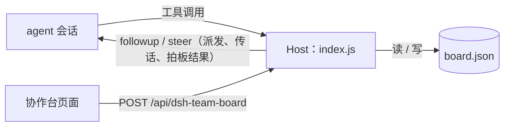

# 开发与接口参考

返回[项目介绍](../README.md)。本文面向需要接入 agent 工具、调用页面 RPC 或维护插件的开发者。

此文档对应仓库当前 main 源码；尚未单独发版的变化见 [CHANGELOG](../CHANGELOG.md)。插件依赖 DSH 注入的服务，不能将 `index.js` 或 `client.js` 单独启动为应用。

## 架构



- **Host 半边**（`index.js`）：唯一的数据规则实现方。持久化、三个工具、RPC 路由，以及把人的动作投递进 live 会话的「最后一公里」。
- **Client 半边**（`client.js`）：往 `sidebar.panellist` 注册图标、往 `main` 注册页面，用宿主主题变量画 UI。
- 页面和工具走的是**同一批 Host 函数**，所以页面提交的拍板、agent 写的任务不会各算各的。
- 投递走 DSH 的 `agents` 服务：`agents.get(sessionId)` 拿到 live agent，再用 `agent.followup(message)` 把消息放进它的收件箱（运行中的 agent 可选 `steer`）。投递成功只代表消息被收件箱接收，不代表 agent 已经处理。

## agent 工具参考

三个工具都返回纯 JSON，可以直接被下一步的模型读。

### `collab_board_read`

读整块板；给 `projectId` 就只读一个项目。

```json
{}
```

```json
{ "projectId": "P-1" }
```

返回 `{ projects, decisions, tasks }`（单项目时返回 `{ project, decisions, tasks }`）。已拍板的卡带 `status: "answered"` 和 `answer`。

### `collab_task_upsert`

建任务或更新任务。**不给 `taskId` 就是新建**（自动分配 `T-080` 这样的 id）。

```json
{
  "title": "工作台分析区显示细菌计数图",
  "checks": ["图能渲染", "空数据显示占位"],
  "progressTotal": 2,
  "commander": "claude",
  "executor": "deepseek"
}
```

下面的任务 ID 请替换为创建接口实际返回的值。

```json
{
  "taskId": "<创建接口返回的任务 ID>",
  "status": "doing",
  "doneChecks": ["图能渲染"],
  "progressPassed": 1,
  "note": "等前端联调"
}
```

| 参数 | 类型 | 说明 |
| --- | --- | --- |
| `taskId` | string | 已有任务 id；省略则新建 |
| `projectId` | string | 新建时省略用第一个项目；更新时必须与已有任务所属项目一致 |
| `title` | string | 标题（新建时必填；提供时不能是空白） |
| `status` | `todo` \| `doing` \| `done` | 状态 |
| `commander` / `executor` / `reviewer` | string | 三个角色 |
| `progressPassed` / `progressTotal` | integer | 非负安全整数，手动进度须满足通过数 ≤ 总数；有验收清单时以清单计算结果为准 |
| `checks` | string[] | 验收项全量替换；**同名的完成态会保留** |
| `doneChecks` | string[] | 本次标记通过的验收项 |
| `note` | string | 卡上的备注 |

### `collab_decision_ask`

发一张待拍板卡。**一个问题一张卡**，标题短一点。任务相关的问题请携带 `taskId`，决策卡会记录任务关联，并从任务确定项目；同时提供 `projectId` 时两者必须一致。

```json
{ "taskId": "T-078", "projectId": "P-1", "title": "什么时候数", "detail": "**AI 分析完成后自动数**，跟在分析任务里，不加按钮" }
```

`taskId` 和 `projectId` 都省略时，如果提问会话仅有一条仍在进行的派发任务，会自动关联该任务；单项目、无派发上下文时仍默认用唯一项目。会话对应多条进行中任务，或多项目下无法确定归属时，会要求显式提供 `taskId` 或 `projectId`，不会悄悄归入第一个项目。派发提示中已给出准确参数。

`detail` 支持 `**加粗**`。工具会记下调用它的会话；人提交拍板后，Host 把答案作为一条 user 消息**自动投回那个会话**（`decision.sourceSessionId` / `decision.delivery` 可在板上看到）。Team 队友会直接唤醒；普通 subagent 结束回合后会被回收，所以它提的问题会转投到顶层父会话。agent 仍然可以用 `collab_board_read` 回读，但不需要靠轮询才能知道答案。

## 页面 RPC

页面的每个动作都对应 Host 上一个方法，和 agent 工具共享同一批底层函数。RPC 走浏览器已认证的 `POST /api/dsh-team-board`，统一返回 `{ ok: true, value }` 或 `{ ok: false, error }` 信封。

| 方法 | 载荷 | 返回 | 谁用 |
| --- | --- | --- | --- |
| `state` | `{}` | `{ board }` | 页面轮询 |
| `listSessions` | `{}` | `{ sessions: [{ id, title, cwd, status, kind, createdAt, events }] }` | 页面：派发 / 传话的会话下拉 |
| `answerDecision` | `{ id, answer }` | `{ board, delivery? }` | 页面（**只有人**）；有提问会话时自动投递答案 |
| `deliverDecision` | `{ id, force? }` | `{ board, delivery }` | 页面：未送达时重发；已送达的默认拒绝，`force: true` 才重复发送 |
| `setTaskStatus` | `{ id, status }` | `{ board }` | 页面 |
| `toggleCheck` | `{ taskId, index, ok? }` | `{ board }` | 页面；省略 `ok` 则翻转，并按勾选结果重算 `progress` |
| `createProject` | `{ name, goal? }` | `{ board, project }` | 页面 / 新建项目 |
| `upsertTask` | 同 `collab_task_upsert` | `{ board, task }` | 页面 / 新建任务 |
| `dispatchTask` | `{ taskId, sessionId, requestId, note?, mode? }` | `{ board, task, delivery }` | 页面 `GO`：把任务 prompt 投进会话，任务转 `doing` |
| `sendMessage` | `{ sessionId, text, requestId, taskId?, mode? }` | `{ board, task?, delivery }` | 页面「传话」：把人的一句话投进会话 |

`dispatchTask` / `sendMessage` 必须携带非空的 `requestId`（建议 UUID，最长 200 字符）。同一次操作重试必须沿用它；明确发起另一条消息时才换新 ID。相同 ID、相同参数的已成功请求返回原投递结果，不重复发送；相同 ID 改参数会报错。页面会自动管理 ID，并在响应丢失或出现投递警告时保留到当前 tab 的 `sessionStorage`，刷新页面后也能沿用。升级这项 RPC 契约后，请重启 DSH 并刷新页面，让 Host / Client 同时更新。

发送前先持久化 `deliveryRequests` 意图记录，发送后再保存回执。如果回执保存失败，返回成功结果及 `warning`，页面提示先核对目标会话；磁盘上的 `pending` 记录阻止同一请求再次发送，重启后仍有效。`pending` 表示投递结果不确定，可能是发送前进程退出，也可能是已发送但回执未保存；不会自动重发。核对会话后，可用新 ID 明确发起一次新发送；拍板可在核对后显式用 `force: true` 重发。此机制不保证宿主收件箱与看板之间的事务性「恰好一次」投递。

`mode` 默认 `queue`（agent 下一轮处理）；传 `steer` 时，若 agent 正在运行，会在最近的步骤边界插入。`delivery` 形如 `{ status: "sent" | "failed", sessionId, sessionTitle, mode, at, error? }`。

## 数据

一块板就是一个 JSON 文件，默认在 `~/.dsh/team-board/board.json`（`$DSH_HOME` 存在时优先用它；Windows 上是 `%USERPROFILE%\.dsh\team-board\board.json`）：

```jsonc
{
  "version": 1,
  "revision": 12,
  "updatedAt": "2026-11-04T08:08:10.518Z",
  "projects": [{ "id": "P-1", "name": "AHP 协作台", "goal": "…", "currentTask": "T-078" }],
  "decisions": [{
    "id": "D-1", "title": "什么时候数", "status": "answered", "answer": "分析完成后自动数",
    "sourceSessionId": "session-…", "sourceSessionTitle": "执行会话",
    "delivery": { "status": "sent", "sessionId": "session-…", "sessionTitle": "执行会话", "mode": "queue", "at": "2026-11-04T08:20:00.000Z" }
  }],
  "tasks": [{
    "id": "T-078", "title": "后端：…", "status": "doing",
    "commander": "claude", "executor": "deepseek", "reviewer": "human",
    "progress": { "passed": 0, "total": 3 },
    "checks": [{ "label": "新测试全过", "ok": false }],
    "dispatches": [{ "status": "sent", "sessionId": "session-…", "sessionTitle": "执行会话", "mode": "queue", "at": "…", "note": "先跑测试" }],
    "messages": [{ "text": "先别动前端", "at": "…", "sessionId": "session-…", "sessionTitle": "执行会话" }]
  }]
}
```

`dispatches` 只保留最近 10 条，`messages` 也只保留最近 10 条，避免单卡无限增长。旧版 `board.json` 没有这些字段也能直接读，页面按「无派发 / 无投递」渲染。

写入走 `临时文件 + rename`，并且所有变更串行化。修改使用独立副本，保存成功后才更新缓存；失败时缓存与已保存数据保持一致。Windows 上如果目标文件被杀毒 / 索引器短暂占用，会先重试，仍失败就报错并保留原文件，不再退化为复制覆盖。文件损坏时会先复制备份成 `board.json.corrupt-<时间戳>.json` 再重建；备份失败会停止恢复，保留原文件并报错。

`revision` 每次成功保存后递增，并随文件持久化；旧文件没有该字段时从 0 开始。页面对轮询和各项操作的返回值统一比较版本，忽略迟到的旧快照，避免新状态被旧响应覆盖。它用于一个 Host 内的响应排序，不提供多进程同时写同一文件的协调；手动恢复更旧的数据后需刷新页面。

`deliveryRequests` 是投递防重复日志，旧文件没有该字段也可正常读取。它独立于每张卡最近 10 条的显示记录，保留请求 ID、参数摘要及投递状态，不会随卡片历史截断；目前不自动清理，以保持旧请求重试时的防重复能力。

## 目录结构

```
.
├── index.js                 # Host：存储 + 三个工具 + 10 个 RPC 方法 + 会话投递
├── client.js                # Client：侧边栏图标 + 协作台页面（GO 派发 / 传话 / 投递状态）
├── package.json             # bundle 清单（dsh.bundle / dsh.client）
├── cordis.patch.yml         # 把插件插入 profile 的 patch
├── locale/{zh,en}.json      # 插件页显示的名称与描述
├── icon.svg                 # 插件图标
├── test/verify-host.mjs     # Host 行为回归（77 项）
├── test/check-client.mjs    # Client 静态契约检查
├── test/verify-reliability.mjs # 存储与投递异常回归
├── test/verify-client-retry.mjs # Client 重试、页面重载与响应乱序回归
├── test/verify-board-rules.mjs # 多项目、任务校验与版本持久化回归
├── .github/workflows/ci.yml # CI：push / PR 在 Linux / macOS / Windows 跑全部检查
├── CHANGELOG.md
├── LICENSE                  # MIT
└── README.md
```

